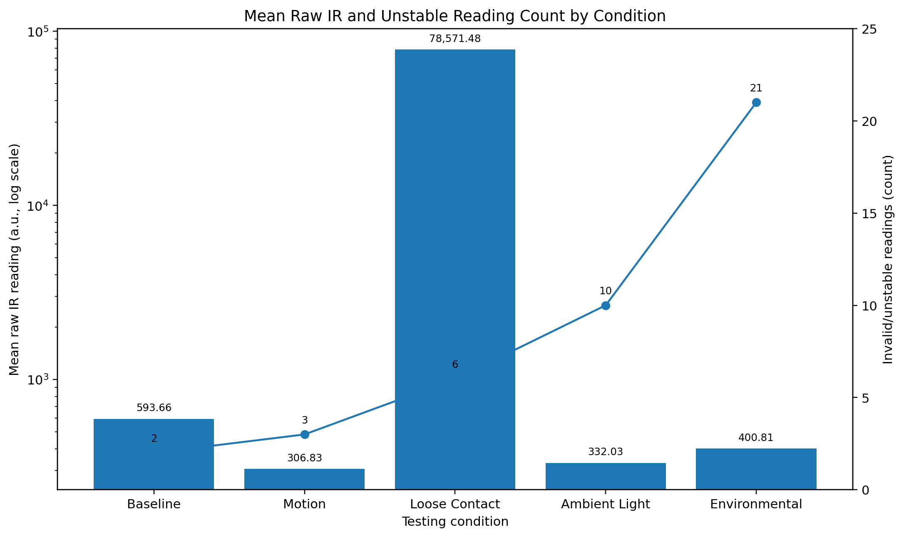

# Low-Cost Optical Sensor Reliability Study

**Jeseca Sakla | Johns Hopkins Biomedical Engineering Innovation | Summer 2026**

This repository documents a student-led biomedical engineering experiment completed through Johns Hopkins Biomedical Engineering Innovation (BMEI). The project tested how simulated real-world disturbances affected the stability of raw infrared (IR) output from a low-cost MAX30102 optical sensor connected to an Arduino Uno R4 Minima.

## Research question

How do motion, loose sensor contact, ambient light, and environmental disturbance affect the reliability of raw infrared output from a low-cost optical heart-rate sensor?

## Experimental design

Five bench-top conditions were tested:

- Baseline
- Motion
- Loose Contact
- Ambient Light
- Environmental Disturbance

Each condition was repeated three times. The original Arduino acquisition sketch collected **30 raw IR readings per trial** with a programmed **500 ms interval** between readings. The same Arduino board, sensor, acquisition code, and general recording procedure were maintained across conditions.

This project evaluated **raw IR signal reliability**, not BPM, SpO2, medical diagnosis, or clinical accuracy. No human-subject heart-rate data were collected.

## Results

| Condition | Mean raw IR (a.u.) | SD (a.u.) | Range (a.u.) | Invalid / unstable count |
|---|---:|---:|---:|---:|
| Baseline | 593.66 | 22.66 | 151 | 2 |
| Motion | 306.83 | 13.08 | 69 | 3 |
| Loose Contact | 78,571.48 | 48,943.88 | 130,209 | 6 |
| Ambient Light | 332.03 | 35.64 | 150 | 10 |
| Environmental | 400.81 | 1,320.50 | 11,920 | 21 |

**Key findings:** Loose contact produced the greatest overall signal variation, with the highest mean raw IR value, standard deviation, and range. Environmental disturbance produced the highest invalid/unstable reading count. The results therefore partially supported the original hypothesis: disturbance affected reliability, but not every reliability metric changed in the same way.

## Repository contents

- `code/original_experiment_code.ino` - original Arduino acquisition code used for the project
- `data/summary_results.csv` - final condition-level results preserved from the completed analysis
- `figures/actual_sensor_setup.jpg` - photograph of the Arduino/MAX30102 hardware setup
- `figures/results_summary.png` - visual summary of the preserved results
- `analysis/plot_results.py` - post-course reproducibility script that generates the results figure from the CSV
- `report/Jeseca_Sakla_Optical_Sensor_Project_Report.pdf` - concise portfolio technical report
- `requirements.txt` - Python package required to reproduce the figure

## Data note

The archived project materials preserve the final condition-level summary results but not the original raw Serial Monitor logs. No raw measurements have been reconstructed or invented. The invalid/unstable counts shown here are the final counts reported in the completed project analysis.

## Project context

This work was completed as a final project through Johns Hopkins Biomedical Engineering Innovation. Course instructors and teaching staff provided guidance and feedback during the project. The repository is a portfolio archive of the completed work and is not presented as an independent or peer-reviewed study.

## References

Bent, B., Goldstein, B. A., Kibbe, W. A., & Dunn, J. P. (2020). *Investigating sources of inaccuracy in wearable optical heart rate sensors*. npj Digital Medicine, 3, 18.

Charlton, P. H., et al. (2022). *Wearable photoplethysmography for cardiovascular monitoring*. Proceedings of the IEEE, 110(3), 355-381.

Castaneda, D., Esparza, A., Ghamari, M., Soltanpur, C., & Nazeran, H. (2018). *A review on wearable photoplethysmography sensors and their potential future applications in health care*. International Journal of Biosensors & Bioelectronics, 4(4), 195-202.
